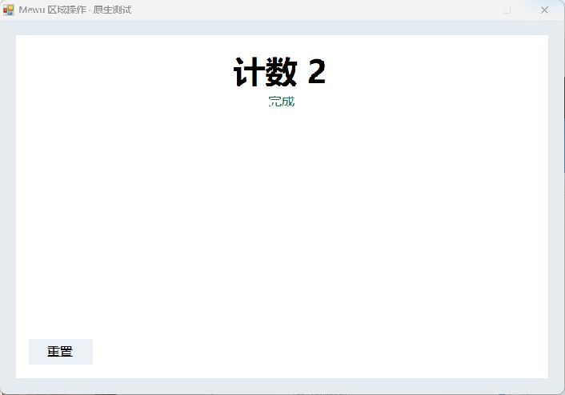
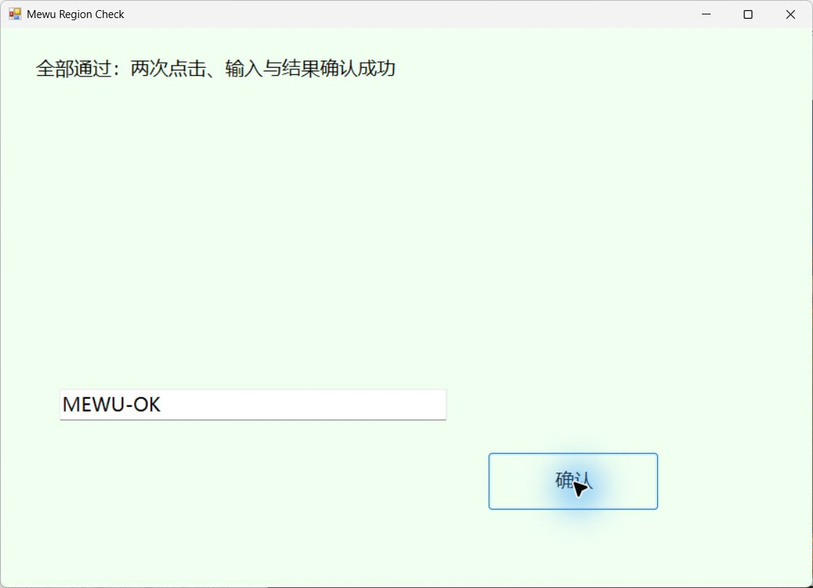
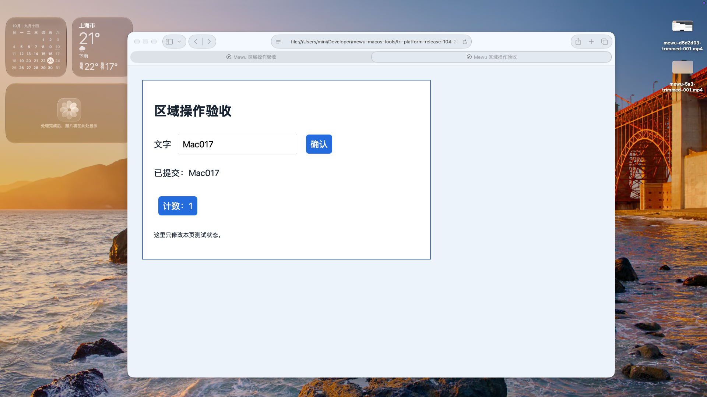
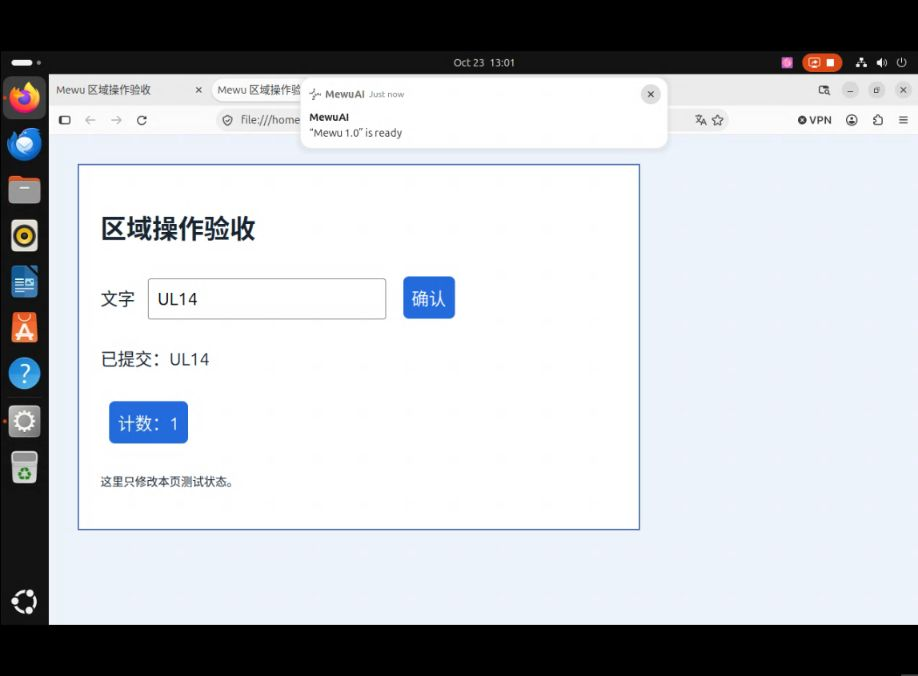

# 区域操作 Agent

在 Mewu 原有截图界面框选区域，直接在对话条输入任务。插件通过模型观察当前区域、执行一个动作，再用新截图决定下一步。

原生输入支持 Windows、macOS 与 GNOME 50 Wayland x64；具体系统权限与 Linux 桌面限制见下方 0.1.4 说明。需启用插件并配置支持图像和工具调用的模型。Esc 或停止会撤销后续动作。

## 安装与开发

在 Mewu 的插件市场搜索 **区域操作 Agent**，核对本项目源码后安装。已有版本的发行资产保留在[社区市场发行页](https://github.com/abnste/mewu-plugins/releases)，不变更用户现有的更新来源。

本仓库根目录的 mewu-plugin.json 与 index.mjs 是可独立打包的完整插件源码，无须修改 Mewu 核心。[Mewu API SDK](https://github.com/abnste/mewu_ai/tree/master/packages/sdk) · [打包与 GitHub 投稿](https://github.com/abnste/mewu_ai/tree/master/tools/extension-market)

## 0.1.3

观察或模型请求失败会把明确错误交回调用插件的 Agent。每一步输入成功后先保留执行记录，再获取新截图；反馈失败会明确标记尚未确认，不能重复执行已经发出的动作。操作本身结果未知时停止，不自动重放。

新版 Mewu 宿主支持包含标题栏的整窗选区，并在操作期间保持真实目标可见。这两项需要更新宿主，单独更新插件不会修改旧宿主的窗口边界和呈现行为。旧宿主缺少细分错误码时仍显示通用错误。

## 实际效果

以下来自 Windows 原生运行的 0.1.2：普通对话条发起任务，目标接收两次实际鼠标操作，第二个按钮的位置由第一次操作后新生成的截图确定。第一张仅裁出对话界面，未重绘或合成内容。

0.1.3 代码在 Windows 的实际验收：含标题栏的整窗选区，由原对话条发起，模型依次点击“开始”“继续”，输入 `MEWU-OK`，再点击“确认”。验收程序实际接收全部输入。另测跨窗选区返回明确错误且没有点击，以及 Esc 中止后不再输入。测试使用同一插件代码的独立本地标识，未改变操作逻辑。

## 许可

MPL-2.0，与 Mewu 一致。

## 0.1.4：三端区域操作

需要 MewuAI 1.0.5 或更新版本。Windows、macOS、GNOME 50 Wayland x64 复用同一份插件代码，由宿主提供原生坐标、输入与截图适配。macOS 需要录屏与辅助功能权限；Linux 需要 [Mewu Desktop Witness](https://github.com/abnste/mewu_ai/tree/master/tools/linux-desktop-witness) 和系统 Portal 当次授权，其他 Linux 桌面尚不支持区域输入。

直接在 Mewu 对话条引用选区并发送任务。插件每次依据截图决定一个动作，随后取得新截图；页面尚未更新时可仅重新观察，不重复输入。停止、失去目标、密码框或结果未知时不会盲目重放。

下面是真实桌面上的输入、确认与计数结果。

